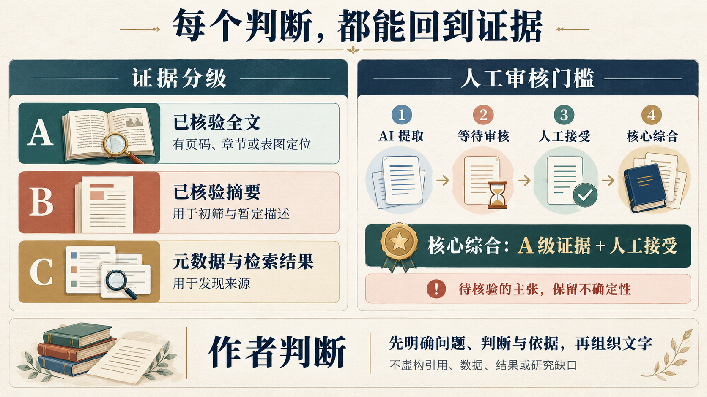

# 社会科学研究工作流 · 三技能合集

一次安装三个互相配合的 Codex skill，覆盖研究阶段诊断、经济学文献综述，以及论文成稿与修改。三个 skill 的完整参考资料均包含在本仓库中。


[详细能力说明](docs/capabilities.md) · [一次安装](#一次安装完整合集) · [使用示例](#使用示例)

## 三个 skill 如何分工

| Skill | 职责 | 入口 |
| --- | --- | --- |
| `social-science-research-workflow` | 诊断研究阶段、确定下一步、统一证据门槛与作者规范 | [SKILL.md](skills/social-science-research-workflow/SKILL.md) |
| `economics-literature-review` | 文献发现、筛选、全文提取、模型谱系、假设与机制比较、综述及证据审计 | [SKILL.md](skills/economics-literature-review/SKILL.md) |
| `research-paper-writing` | 章节结构、段落衔接、主张与证据对齐、成稿修改及审稿检查 | [SKILL.md](skills/research-paper-writing/SKILL.md) |

典型推进关系：

```text
工作流诊断当前研究阶段
    → 经济学文献检索、精读与综合
    → 人工审核核心证据
    → 论文成稿与修改
```

写作技能与经济学文献技能共同读取工作流中的作者判断规范。三个目录需保持并列、保留原名；专项技能交接后，工作流的证据门槛和作者规范继续适用。

写作技能的章节参考和示例主要来自 ML/CV/NLP 写作场景。用于社会科学或经济学时，应按研究问题、假设、数据、识别、机制和制度背景调整，不直接套用技术论文结构。

## 具体能帮你完成什么

### 1. 整体工作流：判断研究卡在哪里，再推进下一步

输入一个研究想法、已有材料或当前困难，工作流先识别研究阶段、证据状态和主要缺口，再选择本轮动作。可围绕一个局部问题使用，也可用 `full` 模式持续推进研究。

| 能力 | 具体处理 | 可交付成果 |
| --- | --- | --- |
| 研究问题收敛 | 明确对象、关系、时空边界与可回答形式，检查文献和材料可行性 | 候选问题、边界说明、可行性判断与缺口 |
| 阅读与文献组织 | 区分速读和精读，识别论文结构、主张、证据与限制 | 初筛卡、带原文锚点的阅读笔记、文献生态图表 |
| 论证闭环 | 核对问题、文献动机、背景、数据、设计和结果是否承接 | 断链定位、需要补充的证据与修改方向 |
| 研究设计验证 | 从威胁出发检查假设与检验方案，区分稳健性、异质性和机制 | 威胁—假设—证据矩阵、验证计划、主张边界 |
| 展示与沟通 | 围绕听众需要理解或决定的事情，组织图表解释和汇报 | 图表说明、汇报结构、研究求助 brief |
| 持续推进 | 保留版本与反馈；问题、数据或设计变化时识别回退范围 | 阶段记录、反馈台账、下一步行动；明确要求时提供训练计划 |

### 2. 经济学文献综述：从“读过哪些论文”推进到“模型怎样演变”

输入研究问题、论文清单或全文材料，按范围界定、发现、筛选、获取、提取、人工审核、谱系、综合、草稿与审计推进。各阶段按实际任务使用。

| 能力 | 具体处理 | 可交付成果 |
| --- | --- | --- |
| 可追溯检索 | 记录数据库、日期、原始查询、筛选条件和结果；保留排除理由 | 检索日志、候选文献清单、筛选记录 |
| 全文证据提取 | 以 DOI / citekey 去重，定位假设、命题、机制和结果 | 一篇来源一份规范笔记、页码或章节锚点 |
| 模型谱系比较 | 比较前身模型、基准假设、假设变化、新变量、机制与新结果 | 模型谱系表、机制对照表、理论扩展比较 |
| 综合与候选缺口 | 按问题、谱系或机制组织文献，检查矛盾发现与反证 | 文献综合、候选缺口及其检索边界 |
| 主张审计 | 将综述中的重要判断映射回经人工接受的全文证据 | 主张—证据台账、待核验项、需弱化或删除的主张 |

例如，比较两篇理论论文时，会问“后一篇改变了哪个假设，这如何改变机制和结论”，并寻找原文依据。候选研究缺口在检索不足时保留 `needs-search`。

### 3. 论文写作与修改：把已有判断写清楚，让证据承担论证

输入草稿、已有研究发现和来源材料，先确定文章要表达的主要判断，再按章节和段落处理结构与语言。

| 能力 | 具体处理 | 可交付成果 |
| --- | --- | --- |
| 章节组织 | 按摘要、引言、相关研究、方法、实验或结果、结论的任务选取参考指导 | 章节草稿或修改稿 |
| 段落衔接 | 检查段落主旨、术语、句间关系和对文章主张的支持 | 论点清楚、信息连贯的成稿 |
| 反向提纲 | 从已有正文还原主要主张、段落任务及支持证据 | 修正重复、游离和断链内容后的正文 |
| 主张与结果对齐 | 检查摘要、引言、结果讨论中的强判断是否得到研究支持 | 支持充分的表述，以及需缩小或删除的判断 |
| 图表与审稿检查 | 检查图表可读性、格式一致性，以及贡献、方法和证据方面的问题 | 图表修改建议；用户要求审稿时提供问题与修改建议 |

遵守共享作者规范：动笔前明确问题、判断与依据；写作性修改前核对真实原文参照；完成后自行修正，默认交付成稿。内部提纲、逐段分析与检查清单按用户需求提供。

更完整的输入要求、七种工作模式、产物示例和使用边界，见 [详细能力说明](docs/capabilities.md)。

## 一次安装完整合集

### 推荐：将下面的请求复制给 Codex

```text
请使用 $skill-installer，从 GitHub 仓库
markgfu/social-science-research-workflow
一次安装以下三个路径中的全部技能：

skills/social-science-research-workflow
skills/economics-literature-review
skills/research-paper-writing

保持三个技能的目录名，并安装到同一个 skills 目录，
以保留它们之间的相对引用。
```

安装完成后，在下一轮对话使用 `$social-science-research-workflow` 开始任务，也可以单独调用另外两个技能。

### 命令行：一次调用安装三个 skill

以下命令使用 Codex 自带的 `skill-installer` 和 Python，无需分别运行三次。

Windows PowerShell：

```powershell
$codexDir = if ($env:CODEX_HOME) { $env:CODEX_HOME } else { Join-Path $HOME '.codex' }
python (Join-Path $codexDir 'skills/.system/skill-installer/scripts/install-skill-from-github.py') --repo markgfu/social-science-research-workflow --path skills/social-science-research-workflow skills/economics-literature-review skills/research-paper-writing
```

macOS / Linux：

```bash
python3 "${CODEX_HOME:-$HOME/.codex}/skills/.system/skill-installer/scripts/install-skill-from-github.py" --repo markgfu/social-science-research-workflow --path skills/social-science-research-workflow skills/economics-literature-review skills/research-paper-writing
```

### 手动安装

下载仓库 ZIP 并解压，将仓库 `skills/` 下的三个完整文件夹复制到同一个 Codex 技能目录：

- Windows：`%USERPROFILE%\.codex\skills\`
- macOS / Linux：`~/.codex/skills/`
- 设置了 `CODEX_HOME` 时：该目录下的 `skills/`

最终目录结构应当是：

```text
skills/
├── social-science-research-workflow/
│   ├── SKILL.md
│   ├── agents/
│   └── references/
├── economics-literature-review/
│   ├── SKILL.md
│   ├── agents/
│   └── references/
└── research-paper-writing/
    ├── SKILL.md
    ├── agents/
    └── references/
```

不要把整个仓库嵌套进一个同名 skill 文件夹，也不要只复制三个 `SKILL.md`。

### 已安装旧版或同名 skill

本仓库已由“根目录是单个 skill”改为 `skills/` 下的三技能合集。原工作流的技能名称和调用方式保持不变，安装源路径改为 `skills/social-science-research-workflow`。

安装器遇到已经存在的同名目录会停止。更新前，先将已有目录备份到技能目录之外，保留自己的修改，再安装这三个路径；或手动比较并合并文件。只补装缺失技能时，可以仅向安装器传入缺失的路径。

## 工作流模式


| 模式 | 适用任务 |
| --- | --- |
| `literature` | 检索范围、筛选、枢纽文献、引文追踪和候选缺口 |
| `reading` | 速读初筛、全文精读、证据笔记和范文分析 |
| `writing` | 研究问题、文献动机、背景、数据、设计与结果讨论 |
| `validation` | 识别威胁、稳健性、异质性、机制与主张边界 |
| `presentation` | 图表说明、研究汇报和研究求助材料 |
| `training` | 明确要求时制定训练计划并复盘 |
| `full` | 从想法到论文的阶段推进及回退检查 |

## 使用示例

### 从研究想法开始

```text
使用 $social-science-research-workflow，进入 full 模式。
我的研究方向是地方环境治理中的政策执行差异。
根据我提供的材料判断当前阶段，推进最能降低不确定性的下一步，
需要时使用已安装的经济学文献技能或写作技能。
```

### 专门做经济学文献综述

```text
使用 $economics-literature-review，梳理我提供的理论论文。
比较各篇的前身模型、基准假设、假设变化、机制与结论，
为主要判断保留原文锚点，未经人工审核的笔记标记为 waiting-review。
```

### 修改已有论文

```text
使用 $research-paper-writing，修改我提供的结果讨论。
遵守共享的作者判断规范，保留引用和术语，
依据已有结果解释研究含义，删除没有证据支持的判断。
```

## 证据与写作规则



- **A 级证据**：核验相关全文或一手材料，并提供页码、章节、表图等定位。
- **B 级证据**：核验正式摘要，只支持初筛和暂定描述。
- **C 级证据**：元数据、检索结果或二手提及，只用于发现来源。
- 区分来源主张、模型解释、跨文献综合和研究者推断。
- AI 新建来源笔记先标记为 `waiting-review`。核心跨文献综合与正式成稿要求相关笔记经人工审核，达到 `accepted + A`。
- 未核验的主张保留 `needs-verification`，未完成检索的候选缺口保留 `needs-search`。
- 写作先明确问题、判断与依据；不虚构数据、引用、结果或研究缺口。写作性修改前，按任务检索并核对真实原文参照。

完整要求见 [工作流入口](skills/social-science-research-workflow/SKILL.md)、[作者判断与证据规范](skills/social-science-research-workflow/references/author-judgment-writing.md) 和 [经济学证据政策](skills/economics-literature-review/references/evidence-policy.md)。

## 工具与格式支持

本合集包含完整的三个研究与写作 skill，不会自动安装软件、开通数据库权限或连接账户。联网检索、全文访问、Zotero/Obsidian 集成，以及 PDF、Word、表格和演示文稿的格式处理，需要运行环境中提供相应工具、权限或格式技能。已有材料的研究诊断与文字处理可按可用工具推进，缺失证据仍须明确标记。

## 来源

研究流程主要依据陈硕《非此即彼：社会科学研究指南》的经审核章级笔记整理；作者判断与写作规范来自维护者直接制定的要求。来源位置、规范与工程化约束的区别见 [来源映射](skills/social-science-research-workflow/references/source-map.md)。

仓库不包含原书 PDF 或原始研究项目材料。写作技能包含参考笔记与论文写作示例；其中引用的书籍、论文和第三方材料，其权利归各自权利人所有。

## 项目介绍图

三张介绍图由内置图像模型生成：[技能分工](docs/images/project-overview.png)、[研究推进路径](docs/images/research-journey.png)、[证据与作者判断](docs/images/evidence-and-judgment.png)。对应的完整生成提示词见 [图像制作记录](docs/image-prompts.md)。图片用于介绍工作流，具体执行规则以各技能文件为准。
